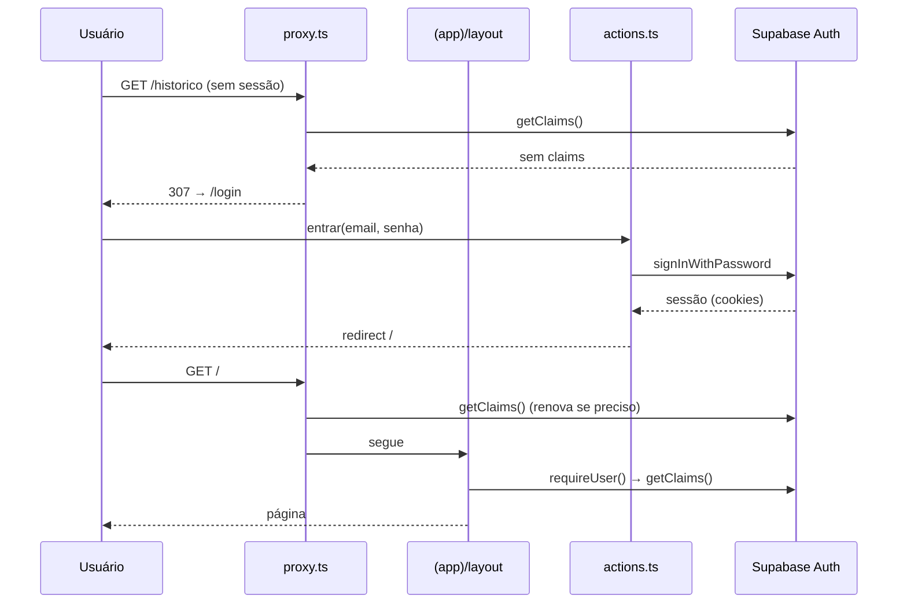

# Mapa do código

> Gerado pelo Cartographer. Último mapeamento: 2026-10-20T01:46:10Z (fim da fase 1, Fundação).

**Ideia** (crmimpressao3d) é um sistema de orçamentos e clientes para uma oficina de impressão 3D, usado por uma só pessoa. A especificação completa está em [prompt-ideia.md](../prompt-ideia.md). A seção 9 dela registra as decisões tomadas depois da revisão.

## Visão geral

```mermaid
graph TB
    subgraph Navegador
        UI[Páginas React<br/>app/*]
        Nav[components/nav.tsx]
    end
    subgraph "Servidor Next.js 16 (standalone)"
        Proxy[proxy.ts<br/>renova a sessão e redireciona]
        Layout["app/(app)/layout.tsx<br/>requireUser()"]
        Actions[Server Actions<br/>app/**/actions.ts]
        Health[/api/health/]
    end
    subgraph "Supabase Cloud"
        Auth[Auth]
        DB[(Postgres + RLS<br/>fase 2)]
    end
    UI --> Proxy --> Layout
    UI --> Actions
    Proxy -- getClaims --> Auth
    Layout -- getClaims --> Auth
    Actions -- signIn/signOut --> Auth
    Actions -. fase 2+ .-> DB
```



## Estrutura de pastas

```
proxy.ts                  sessão e redirecionamento (substitui o middleware.ts no Next 16)
next.config.ts            standalone, cabeçalhos de segurança, Tailwind via Turbopack
Dockerfile                multi-stage: deps → build (ARG NEXT_PUBLIC_*) → runner, sem root, HEALTHCHECK
lib/
  env.ts                  URL e chave do Supabase (NEXT_PUBLIC_*, embutidas no build)
  supabase/client.ts      cliente para o navegador (ainda não usado)
  supabase/server.ts      cliente para o servidor + requireUser()
  supabase/proxy.ts       updateSession(): renova o token e controla rotas públicas e privadas
app/
  layout.tsx              raiz: pt-BR, fonte Geist, metadata e viewport
  login/                  página, formulário (useActionState) e actions entrar/sair
  (app)/layout.tsx        casca autenticada: Nav, cabeçalho com Sair, main
  (app)/*/page.tsx        páginas provisórias (EmBreve) até as fases 4 a 6
  api/health/route.ts     GET → {status:"ok"}
components/
  nav.tsx                 barra lateral (md+) e barra inferior (celular), 5 itens
  em-breve.tsx            aviso "Em construção (fase N)"
.claude/
  agents/                 database-architect, test-engineer, security-auditor, code-reviewer
  skills/fechar-fase/     checklist de fim de fase
docs/CODEBASE_MAP.md      este arquivo
```

## Módulos

### Autenticação e sessão

**Ponto de entrada**: [proxy.ts](../proxy.ts) → [lib/supabase/proxy.ts](../lib/supabase/proxy.ts)

| Arquivo | Papel |
|---|---|
| `lib/supabase/proxy.ts` | `updateSession(request)`: chama `getClaims()`, que renova o token. Rotas públicas: `/login` e `/api/health`. Sem sessão, redireciona para `/login`; com sessão em `/login`, redireciona para `/`. |
| `lib/supabase/server.ts` | `createClient()` lê os cookies via `next/headers`. `requireUser()` retorna `{ supabase, userId, email }` ou redireciona. |
| `lib/supabase/client.ts` | `createClient()` para o navegador. |
| `app/login/actions.ts` | `entrar` valida com Zod, chama `signInWithPassword` e mostra uma mensagem de erro genérica. `sair` chama `signOut`. |

### Casca da interface

`app/(app)/layout.tsx` envolve todas as páginas privadas. Ele chama `requireUser()` e renderiza o `Nav` e o cabeçalho. O `main` tem `pb-24` no celular para não ficar escondido atrás da barra inferior.

### Deploy

O [Dockerfile](../Dockerfile) é construído pelo Coolify a partir do GitHub. `NEXT_PUBLIC_SUPABASE_URL` e `NEXT_PUBLIC_SUPABASE_PUBLISHABLE_KEY` precisam estar marcadas como **Build Variable**. O health check usa `wget` em `/api/health`.

## Fluxos



## Convenções

- Interface, nomes de funções e mensagens em **português** (`entrar`, `sair`, `requireUser` é exceção herdada do padrão Supabase).
- **Leitura** em Server Components, **escrita** em Server Actions com Zod. Sem API REST, exceto `/api/health`.
- Para autorizar, usar `getClaims()` (que valida o JWT), nunca `getSession()`.
- Tailwind direto nas classes; constantes de classe quando repetidas (`inputClass`).
- Tipos de rota (`LayoutProps`, `PageProps`) são globais, gerados por `next typegen`; rode `npm run typecheck`, não `tsc` sozinho.
- Commits pequenos em português; finais de linha LF (`.gitattributes`).

## Pegadinhas

- **Next 16 ≠ Next 15**: leia `node_modules/next/dist/docs/` antes de usar uma API nova (ver [AGENTS.md](../AGENTS.md)). O `cacheComponents` está **desligado** de propósito; o `partialPrefetching` exige ele, então também está fora.
- **`NEXT_PUBLIC_*` são fixadas no build.** Mudar a variável no container sem refazer o build não muda o bundle do cliente. O `lib/env.ts` não valida nada: se a variável faltar, o erro só aparece na primeira chamada ao Supabase.
- **Layouts não re-renderizam** na navegação pelo cliente. O `requireUser()` do layout não substitui a checagem em cada página nem em cada Server Action com dados (fase 2 em diante).
- Não coloque código entre `createServerClient` e `getClaims` em `lib/supabase/proxy.ts`: é ali que o token é renovado.
- O redirecionamento para `/login` descarta o caminho original (não há parâmetro `next`).
- O `/api/health` não testa o Supabase: o container pode aparecer saudável com o banco fora do ar.
- `/calibracao` existe mas não tem item no menu. Vai ganhar um link no Histórico na fase 6.
- O `next/font/google` baixa a fonte durante o build, então o build do Docker precisa de internet.

## Onde mexer

| Tarefa | Arquivos |
|---|---|
| Nova página privada | `app/(app)/<rota>/page.tsx` + item em `components/nav.tsx` se for de menu |
| Nova Server Action | `actions.ts` ao lado da página; começar com `requireUser()` e um schema Zod |
| Rota pública nova | `PUBLIC_PATHS` em `lib/supabase/proxy.ts` |
| Mudar autenticação | `lib/supabase/{proxy,server}.ts`, `app/login/*` |
| Cabeçalhos de segurança | `next.config.ts` |
| Variável de ambiente nova | `lib/env.ts`, `.env.example`, `Dockerfile` (ARG se for `NEXT_PUBLIC_*`), README |
| Banco (fase 2) | `supabase/migrations/*.sql`, depois `lib/database.types.ts` |
| Cálculo (fase 3) | `lib/calculo.ts` + testes Vitest |
