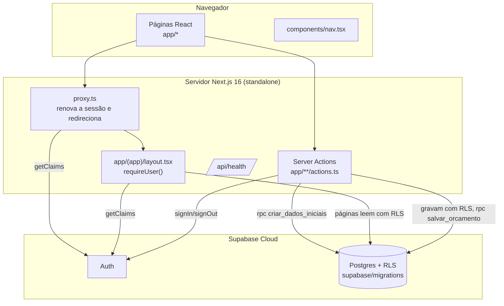
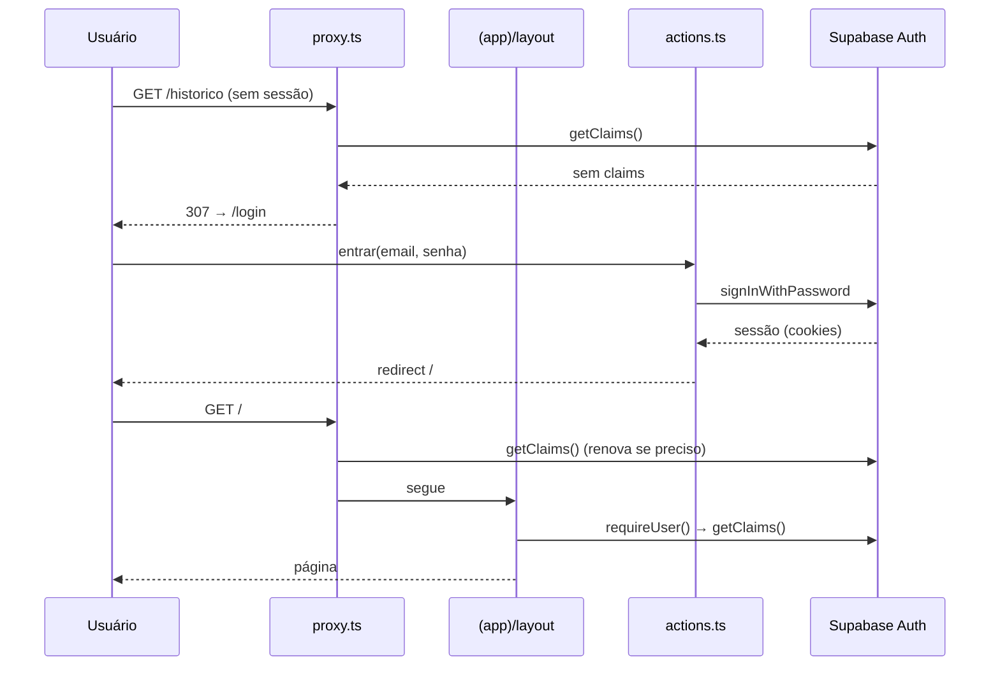

# Mapa do código

> Gerado pelo Cartographer. Último mapeamento: 2026-10-20T03:39:09Z (fase 7, correções das revisões de segurança e de código).

**Ideia** (crmimpressao3d) é um sistema de orçamentos e clientes para uma oficina de impressão 3D, usado por uma só pessoa. A especificação completa está em [prompt-ideia.md](../prompt-ideia.md). A seção 9 dela registra as decisões tomadas depois da revisão.

## Visão geral



## Estrutura de pastas

```
proxy.ts                  sessão e redirecionamento (substitui o middleware.ts no Next 16)
next.config.ts            standalone, cabeçalhos de segurança (com CSP sem nonce), Tailwind via Turbopack
Dockerfile                multi-stage com node:24-alpine fixado por digest: deps → build (ARG NEXT_PUBLIC_*) → runner, sem root, app só leitura, HEALTHCHECK
supabase/
  config.toml             Supabase local (cadastro desligado, seed desligado)
  migrations/             6 migrações: base+configuracoes, cadastros, orcamentos, dados_iniciais, orcamento_manual_e_salvar, followup_e_privilegios
tests/db/
  supabase-stub.ts        PGlite + stub de auth (auth.uid, anon, authenticated, supabase_auth_admin)
  migracoes.test.ts       RLS entre 2 usuários, FKs, triggers, permissões de configuracoes
lib/
  calibracao.ts           calibrar(): desvios, falha real por mesa, sugestões de taxa de falha e desperdício
  clientes.ts             resumirPorCliente()
  historico.ts            carregarHistorico() (server-only): 500 mais recentes + enviados mais antigos (follow-up), usado em /historico e /clientes/[id]
  exportar.ts             gerarPlanilha() com exceljs
  paginar.ts              todasAsPaginas(): contorna o limite de 1000 linhas do PostgREST
  orcamento.ts            schema da entrada do editor, genéricos, texto do WhatsApp, link wa.me, follow-up, indicadores
  calculo.ts              regra de preço (função pura) + precoPorKg, custoPorUnidade, arredondar2
  cadastros.ts            schemas Zod + campos de filamentos, impressoras, insumos e configurações
  form.ts                 EstadoAcao, helpers Zod que leem FormData (decimal, inteiro, checkbox…), lerFormulario
  formato.ts              formatarBRL, paraNumero (vírgula decimal, ponto de milhar)
  database.types.ts       tipos gerados do banco (npm run db:types, precisa de SUPABASE_ACCESS_TOKEN)
  dominio.ts              listas de domínio (tipos de filamento, unidades, bases, status)
  env.ts                  URL e chave do Supabase (NEXT_PUBLIC_*, embutidas no build)
  supabase/server.ts      cliente para o servidor + requireUser()
  supabase/proxy.ts       updateSession(): renova o token e controla rotas públicas e privadas
app/
  layout.tsx              raiz: pt-BR, fontes Archivo e IBM Plex Mono, metadata e viewport
  login/                  página, formulário (useActionState) e actions entrar/sair
  (app)/layout.tsx        casca autenticada: Nav, cabeçalho com Sair, main
  (app)/page.tsx          carrega config/cadastros e o orçamento ?id= (reconciliando cliente/insumos com o banco)
  (app)/editor-orcamento.tsx  editor client: cálculo ao vivo, painel de preço, texto WhatsApp, salvar
  (app)/actions.ts        salvarOrcamento: Zod → recalcula → congela nomes → rpc salvar_orcamento
  (app)/historico/        lista com filtros/indicadores, status otimista, follow-up, entrega, excluir
  (app)/cadastros/        abas filamentos/impressoras/insumos (?aba=), edição inline, actions salvar/excluir
  (app)/configuracoes/    parâmetros da oficina (update só nas colunas permitidas)
  (app)/clientes/         lista com busca e resumo; [id]/ página do cliente com o histórico dele
  (app)/calibracao/       relatório estimado × real e "Aplicar sugestão"
  api/exportar/route.ts   GET → backup .xlsx (sessão + RLS, paginado)
  api/health/route.ts     GET → {status:"ok"}
components/
  formulario.tsx          formulário genérico (campos descritos em lib/cadastros.ts), useActionState via onSubmit
  botao-excluir.tsx       excluir em dois toques
  nav.tsx                 barra lateral (md+) e barra inferior (celular), 5 itens
.claude/
  agents/                 database-architect, test-engineer, security-auditor, code-reviewer
  skills/fechar-fase/     checklist de fim de fase
scripts/sql-editor.mjs     junta migrações num SQL para colar no SQL Editor
e2e/                      Playwright (viewport de celular) contra o Supabase real; limpeza.teardown apaga "E2E %"
Ideia.html                protótipo: referência visual e de comportamento
docs/CODEBASE_MAP.md      este arquivo
```

## Módulos

### Autenticação e sessão

**Ponto de entrada**: [proxy.ts](../proxy.ts) → [lib/supabase/proxy.ts](../lib/supabase/proxy.ts)

| Arquivo | Papel |
|---|---|
| `lib/supabase/proxy.ts` | `updateSession(request)`: chama `getClaims()`, que renova o token. Rotas públicas: `/login` e `/api/health`. Sem sessão, redireciona para `/login`; com sessão em `/login`, redireciona para `/`. |
| `lib/supabase/server.ts` | `createClient()` lê os cookies via `next/headers`. `requireUser()` retorna `{ supabase, userId, email }` ou redireciona. |
| `app/login/actions.ts` | `entrar` valida com Zod, chama `signInWithPassword` e mostra uma mensagem de erro genérica. `sair` chama `signOut`. |

### Banco de dados

**Ponto de entrada**: [supabase/migrations/](../supabase/migrations/)

| Tabela | Observações |
|---|---|
| `configuracoes` | Uma por usuário, criada pelo trigger `on_auth_user_created` (security definer). O cliente só faz `update` nas colunas de parâmetros (grant por coluna); insert e delete são revogados. |
| `clientes`, `filamentos`, `impressoras`, `insumos` | `unique (id, user_id)` para FKs compostas. `tipo` e `unidade` são `text` + CHECK. `insumos.qtd_embalagem` aceita nulo. |
| `orcamentos` | FKs compostas `(x_id, user_id)`: cliente `on delete set null (cliente_id)`, filamento/impressora `restrict`. `parametros` (jsonb) é a fonte para recalcular. O trigger atualiza `status_alterado_em`. CHECKs `preco >= 0` e `custo_total >= 0`. |
| `orcamento_insumos` | Cascata a partir do orçamento; `insumo_id` vira nulo se o insumo for apagado, e o snapshot é mantido. `custo_unitario_snapshot numeric` sem escala. |

Todas as tabelas têm RLS com 4 políticas `(select auth.uid()) = user_id` para `authenticated` (configuracoes tem só select/update), índice em `user_id` e trigger de `updated_at`.

`public.criar_dados_iniciais()` (security definer, só `authenticated`) cria K1C, PLA, ABS e Tinta uma única vez, marcando `configuracoes.dados_iniciais_criados`. É chamada em `entrar` logo depois do login.

### Cálculo

[lib/calculo.ts](../lib/calculo.ts): `calcular(EntradaCalculo)` segue a seção 3 da spec. Recebe percentuais em pontos (5 = 5%) e extras **por peça**. Retorna os componentes em precisão total, `margem_real` = lucro ÷ preço, `valor_hora_real` e os avisos. Lança `RangeError` para NaN, valores negativos ou taxa ≥ 100.

### Formulários e cadastros

O padrão é: `lib/cadastros.ts` define o schema Zod e o `GrupoCampos[]`; a página passa a Server Action com `bind(null, id)` para `<Formulario>`; a action chama `requireUser()`, depois `lerFormulario(schema, fd)`, depois o Supabase com `.select("id")` (0 linhas = não encontrado) e por fim `revalidatePath`. Excluir: filamento e impressora tentam `delete` e, se der 23503, desativam; insumo confere o uso antes.

### Orçamento e histórico

O editor (client) mantém os campos como texto e monta a entrada com `entradaOrcamentoSchema`, o mesmo schema do servidor. Calcula ao vivo com `calcular`. Ao salvar, `salvarOrcamento` revalida, recalcula, congela `material`/`impressora_nome` e grava via `salvar_orcamento(p_id, p_dados, p_insumos)`, uma função SQL security invoker que faz insert ou update e substitui as linhas de insumo numa só transação. `parametros` guarda `{versao, entrada, material, impressora_nome}` e é a fonte para reabrir. Impressora manual e filamento genérico deixam `impressora_id`/`filamento_id` nulos.

### Casca da interface

`app/(app)/layout.tsx` envolve todas as páginas privadas. Ele chama `requireUser()` e renderiza o `Nav` e o cabeçalho. O `main` tem `pb-24` no celular para não ficar escondido atrás da barra inferior.

### Deploy

O [Dockerfile](../Dockerfile) é construído pelo Coolify a partir do GitHub. `NEXT_PUBLIC_SUPABASE_URL` e `NEXT_PUBLIC_SUPABASE_PUBLISHABLE_KEY` precisam estar marcadas como **Build Variable**. O health check usa `wget` em `/api/health`.

## Fluxos



## Convenções

- Interface, nomes de funções e mensagens em **português** (`entrar`, `sair`, `requireUser` é exceção herdada do padrão Supabase).
- **Leitura** em Server Components, **escrita** em Server Actions com Zod. Sem API REST, exceto `/api/health`.
- Para autorizar, usar `getClaims()` (que valida o JWT), nunca `getSession()`.
- Tailwind direto nas classes; constantes de classe quando repetidas (`inputClass`).
- Tipos de rota (`LayoutProps`, `PageProps`) são globais, gerados por `next typegen`; rode `npm run typecheck`, não `tsc` sozinho.
- Commits pequenos em português; finais de linha LF (`.gitattributes`).

## Pegadinhas

- **Consultas para totais precisam de `todasAsPaginas`**: o PostgREST corta em 1000 linhas sem avisar.
- A calibração usa os valores congelados em `parametros.entrada` (taxa de falha, desperdício) e `detalhamento` (horas, gramas, mesas), não a configuração atual.

- **`salvar_orcamento` com `p_id` nulo precisa da chave no JSON** (`p_id: null`). Sem ela o PostgREST não encontra a função (PGRST202).
- Reabrir um orçamento usa `parametros.entrada`, mas `cliente_id` e `insumo_id` são reconciliados com o banco (podem ter sido apagados).
- `useOptimistic` no status do histórico: o valor volta ao do servidor quando a action termina.

- **Formulários usam `onSubmit` + `startTransition(() => formAction(fd))`, não `action={}`**: com `action`, o React 19 limpa o formulário mesmo quando a action devolve erro.
- **Cores só por token** (`bg-panel`, `text-muted`, `border-line`, `text-accent`, `bg-soft`, `text-danger`, `c1`–`c8`), definidos em `app/globals.css` com modo escuro. Não use `zinc`, `teal` etc.
- Se o CSS do `npm run dev` parecer antigo depois de mexer no `globals.css`, reinicie o dev e apague `.next/dev`.
- Os testes E2E alteram o banco real (só registros `E2E …`, apagados no teardown; a margem das configurações é restaurada).

- **Next 16 ≠ Next 15**: leia `node_modules/next/dist/docs/` antes de usar uma API nova (ver [AGENTS.md](../AGENTS.md)). O `cacheComponents` está **desligado** de propósito; o `partialPrefetching` exige ele, então também está fora.
- **`NEXT_PUBLIC_*` são fixadas no build.** Mudar a variável no container sem refazer o build não muda o bundle do cliente. O `lib/env.ts` não valida nada: se a variável faltar, o erro só aparece na primeira chamada ao Supabase.
- **Layouts não re-renderizam** na navegação pelo cliente. O `requireUser()` do layout não substitui a checagem em cada página nem em cada Server Action com dados (fase 2 em diante).
- Não coloque código entre `createServerClient` e `getClaims` em `lib/supabase/proxy.ts`: é ali que o token é renovado.
- O redirecionamento para `/login` descarta o caminho original (não há parâmetro `next`).
- O `/api/health` não testa o Supabase: o container pode aparecer saudável com o banco fora do ar.
- `/calibracao` não tem item no menu: chega-se a ela pelo link no Histórico e em Configurações.
- O navegador nunca fala com o Supabase (não há cliente de navegador): tudo passa por Server Actions e páginas do servidor. Por isso a CSP fica toda em `'self'`; se um dia houver cliente no navegador, inclua o domínio do Supabase em `connect-src`.
- **Não importe tipos de domínio de `lib/database.types.ts`**: ele será sobrescrito pelo `supabase gen types`, que gera `string` para colunas text+CHECK. Use `lib/dominio.ts`.
- **`configuracoes` não aceita insert nem delete do app**, e só aceita update nas colunas de parâmetros. Para adicionar um parâmetro novo, inclua a coluna no `grant update (...)` da migração.
- **FKs compostas** exigem que o `user_id` da linha seja igual ao da linha referenciada. Inserts do app não passam `user_id` (o default é `auth.uid()`).
- **Os testes de banco compartilham estado** dentro do arquivo e dependem da ordem.
- `on delete set null (coluna)` exige Postgres 15 ou mais novo (o Supabase Cloud atual usa 17).
- O `next/font/google` baixa a fonte durante o build, então o build do Docker precisa de internet.

## Onde mexer

| Tarefa | Arquivos |
|---|---|
| Nova página privada | `app/(app)/<rota>/page.tsx` + item em `components/nav.tsx` se for de menu |
| Nova Server Action | `actions.ts` ao lado da página; começar com `requireUser()` e um schema Zod |
| Rota pública nova | `PUBLIC_PATHS` em `lib/supabase/proxy.ts` |
| Mudar autenticação | `lib/supabase/{proxy,server}.ts`, `app/login/*` |
| Cabeçalhos de segurança | `next.config.ts` |
| Variável de ambiente nova | `lib/env.ts`, `.env.example`, `Dockerfile` (ARG se for `NEXT_PUBLIC_*`), README |
| Mudar o schema | nova migração em `supabase/migrations/` (nunca editar uma já aplicada), teste em `tests/db/`, `npm run db:push` e `npm run db:types` |
| Novo valor de domínio | CHECK na migração + `lib/dominio.ts` |
| Novo cadastro/formulário | schema + campos em `lib/cadastros.ts`, action com `lerFormulario`, `<Formulario>` na página, teste em `lib/cadastros.test.ts` e E2E |
| Novo dado no backup | já sai automaticamente (select * por tabela em `ABAS_EXPORTACAO`); tabela nova → adicionar em `lib/exportar.ts` |
| Mudar o cálculo | `lib/calculo.ts` + `lib/calculo.test.ts` (os casos A, B e C não podem mudar) |
